# Horme — アイデア・ボードからの一手と時間割

2026-11-10の実装。画像は生成モックではなく、ビルドしたアプリの実際の画面です。操作テストはDebug限定・メモリ上のサンプルデータを使い、オレンジ色の帯は既存のデモ表示です。

ソース: `78b826957430c6712350edacf560fa8a2665408f`  
[PR #2](https://github.com/reiji55/Todo-for-adhd-iOS.-/pull/2) · [検証実行](https://github.com/reiji55/Todo-for-adhd-iOS.-/actions/runs/42758176354) · [UI操作結果9件成功](validation.json)

TaskCore 103件、配布設定17件、UI操作9件が成功しました。シミュレーターと実機向けのビルドも成功しています。

## 時間割

<a href="timetable-folded-sections-light.png">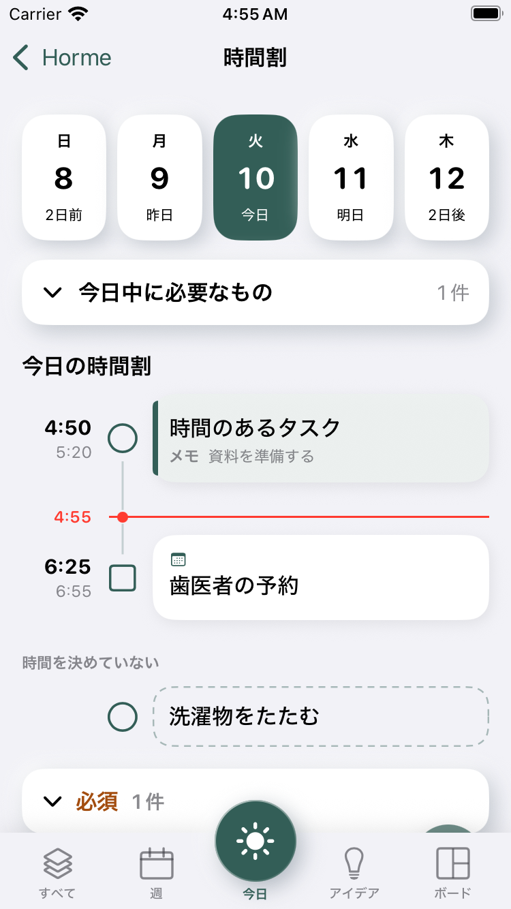</a>
<a href="timetable-untimed-rail-dark.png">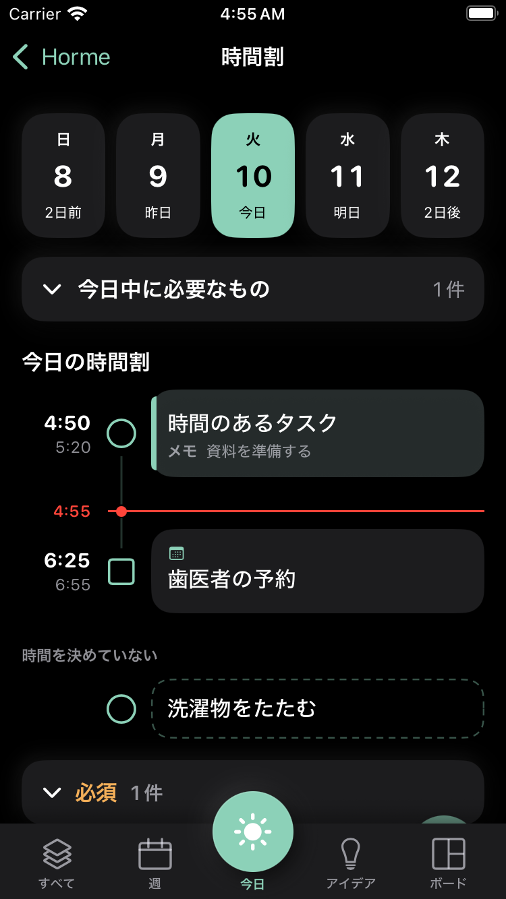</a>
<a href="timetable-deadlines-expanded.png">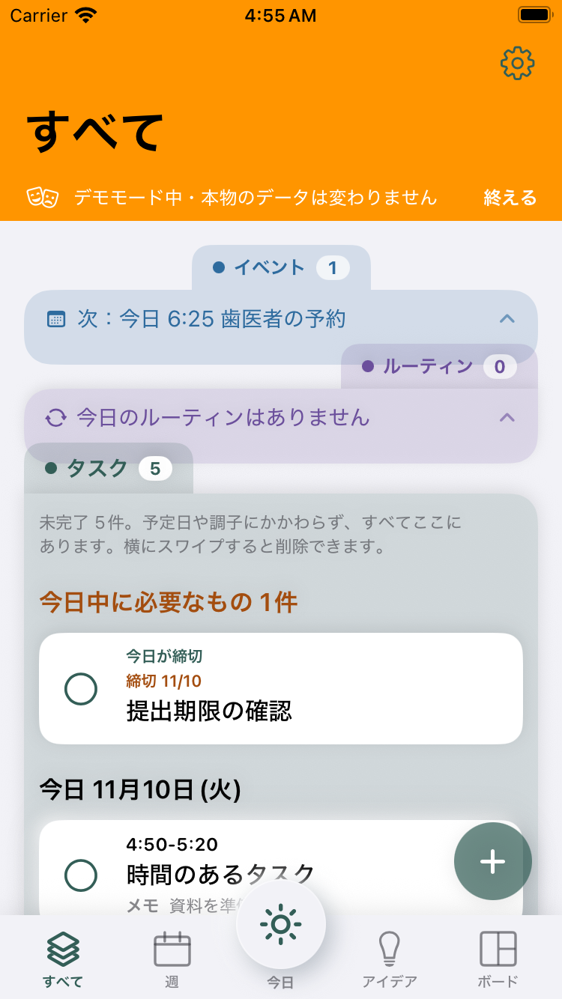</a>
<a href="timetable-five-dates-dark.png">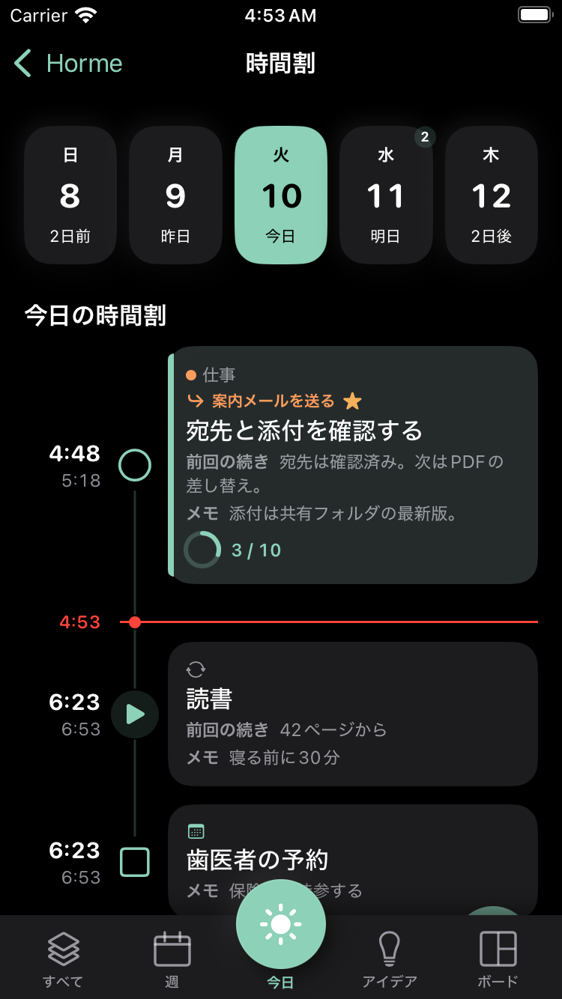</a>

## アイデア

<a href="idea-detail-keeps-project-conversion.png">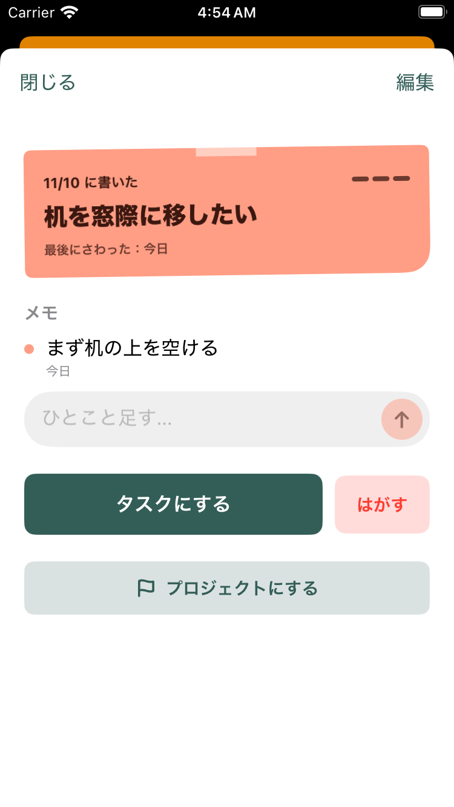</a>
<a href="idea-first-step-simple.png">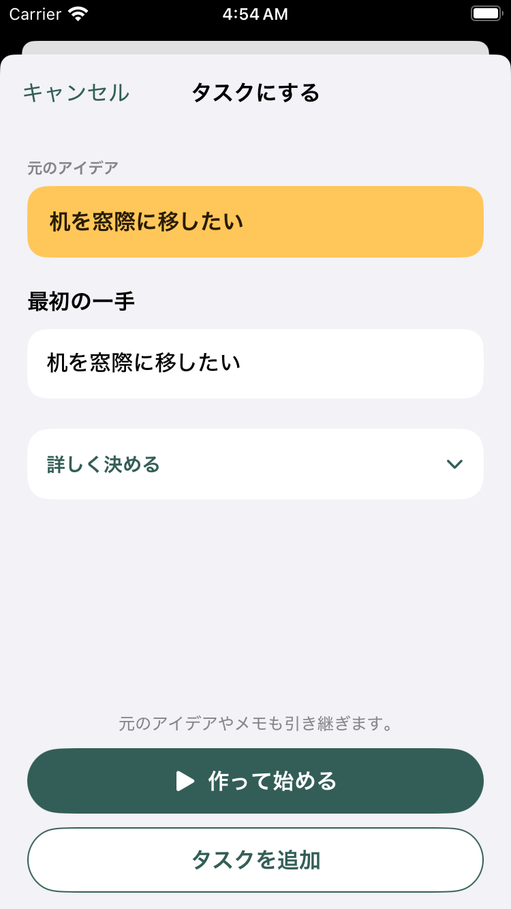</a>
<a href="idea-first-step-optional-details.png">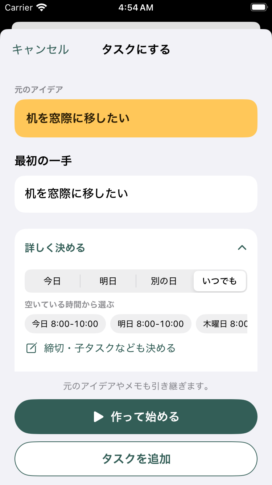</a>
<a href="idea-project-existing-options.png">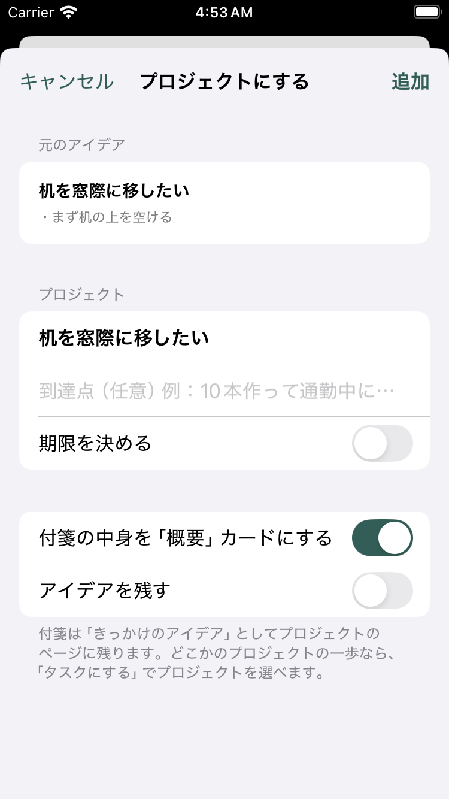</a>

## ボードからの一手

<a href="project-mountain-next-step.png">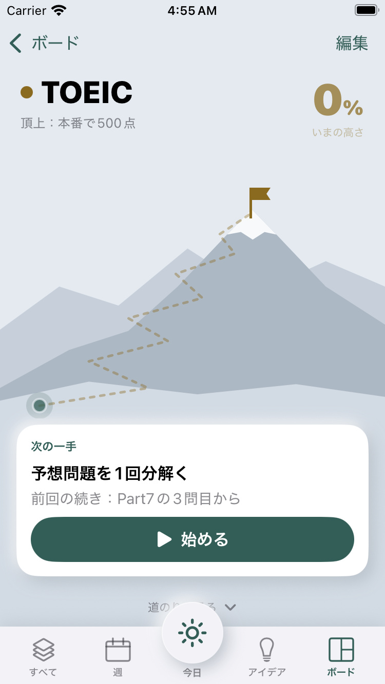</a>
<a href="project-next-step-running-on-today.png">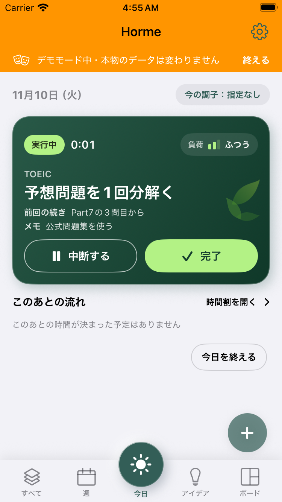</a>
<a href="new-project-first-step-empty.png">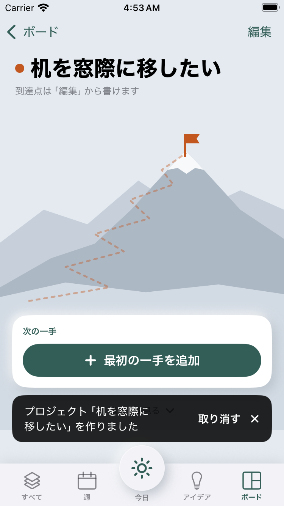</a>
<a href="project-create-first-step.png">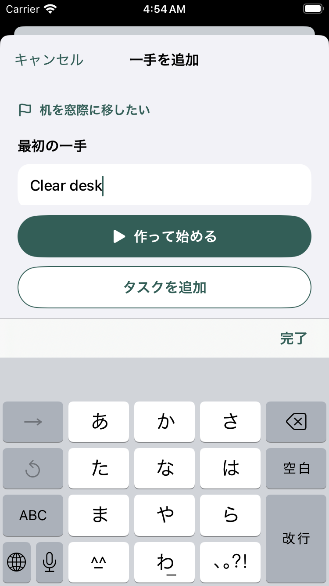</a>
<a href="new-project-first-step-running.png">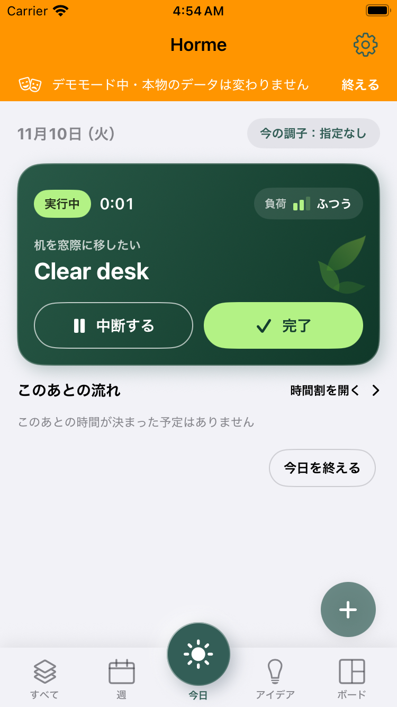</a>

## 追加位置の統一

<a href="ideas-common-lower-right-add.png">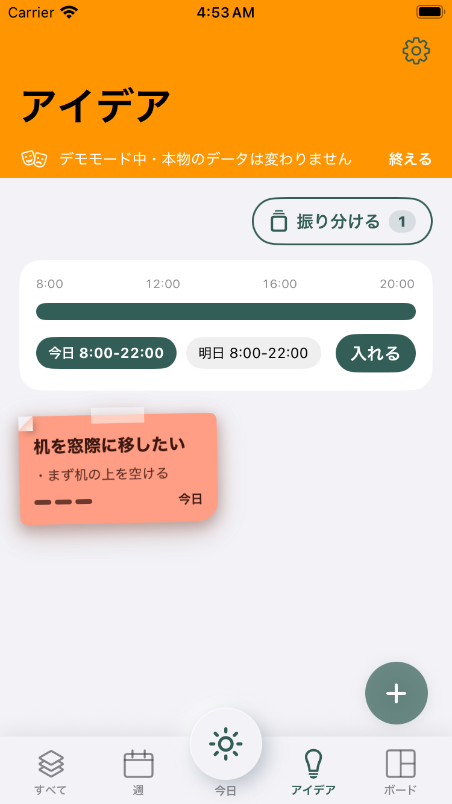</a>
<a href="board-common-lower-right-add.png">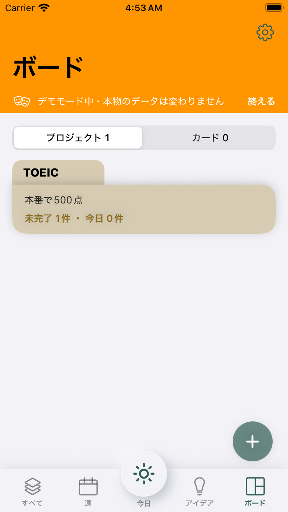</a>
<a href="board-contextual-add-sheet.png">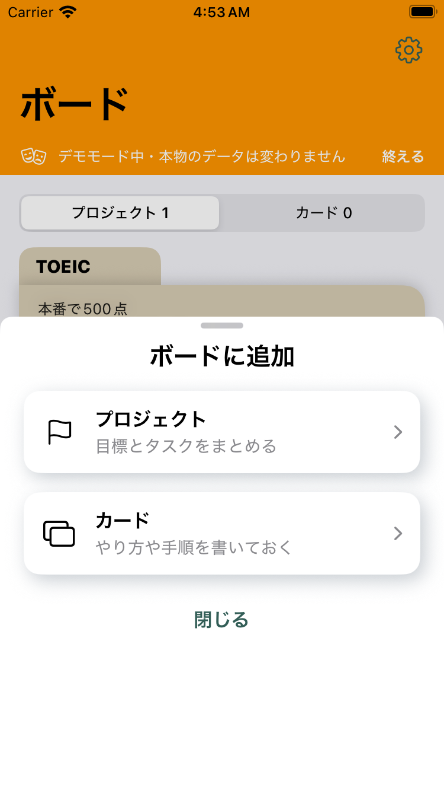</a>

