# 合意外の変更の復元：実画面の比較

実装コミット `b8b37b2d8d2702c16256dd79fc8a3af7521f6386`。[PR #3](https://github.com/reiji55/Todo-for-adhd-iOS.-/pull/3) / [ビルド・操作テスト](https://github.com/reiji55/Todo-for-adhd-iOS.-/actions/runs/42805177966)。

画像はシミュレーターが出力したPNGをそのまま保存しています。生成モックや画像加工は含みません。

## 比較の基準

変更前画像は保存済みスクリーンショットコミット `eca86a73f5a54c6d35a7162da3b41e21460fa452` から取得。生成元は `ee99673bddae71286eef6a063d104c6d3dd22f83` で、`App/NowView.swift` は今回の復元基準 `3990d1bc88a6fdf81a2ee398aee37a5a409521b1` と同一です。カード画像のサンプル内容は同じで、スクリーンショット用スクリプトも同一です。撮影日の違いで日付・曜日・時間の文脈は異なります。

iPadのいまカードの比較画像だけは `833aa2c` / CI `42802031075` から採用しています。最終版の該当キャプチャは起動直後の空白画面を撮影しており、カード表示の確認には使えません。[元のキャプチャ](diagnostics/iPad-now-card-launch-capture-b8b37b2.png)も保存しました。採用画像のカード・描画部品・ストア・ルート・時間割のコードは最終版と同一です。ほかのiPad画面は最終版で表示され、起動ログにクラッシュや処理の停滞はありませんでした。

合意した緑のカード、開始・中断・一時メモ、丸の進捗、時間割のレイアウト、②A・③A・⑤Aは維持しています。機能と復元対象の一覧は[実装側の変更範囲](https://github.com/reiji55/Todo-for-adhd-iOS.-/blob/b8b37b2d8d2702c16256dd79fc8a3af7521f6386/docs/RESTORE-SCOPE.md)を参照。

## いまカード

| 変更前 | 復元後 |
| --- | --- |
| 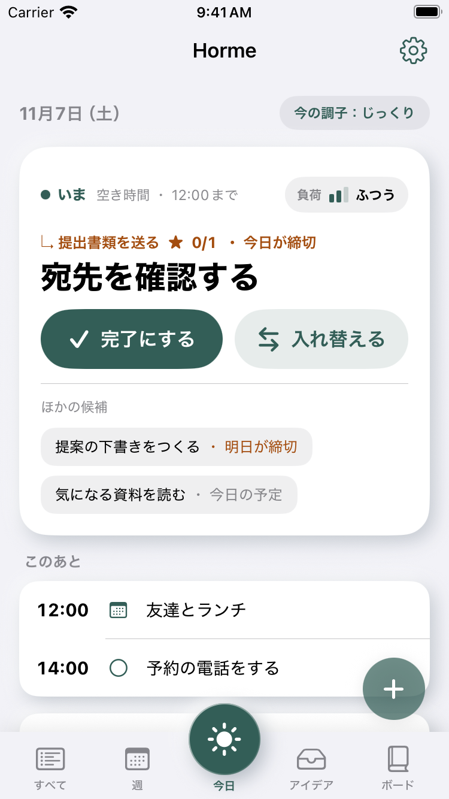 | 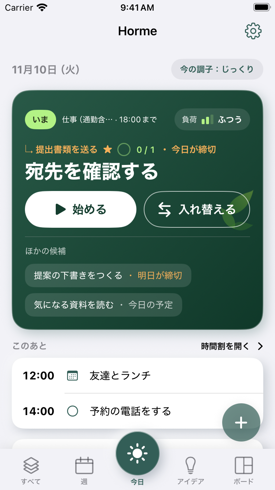 |
| 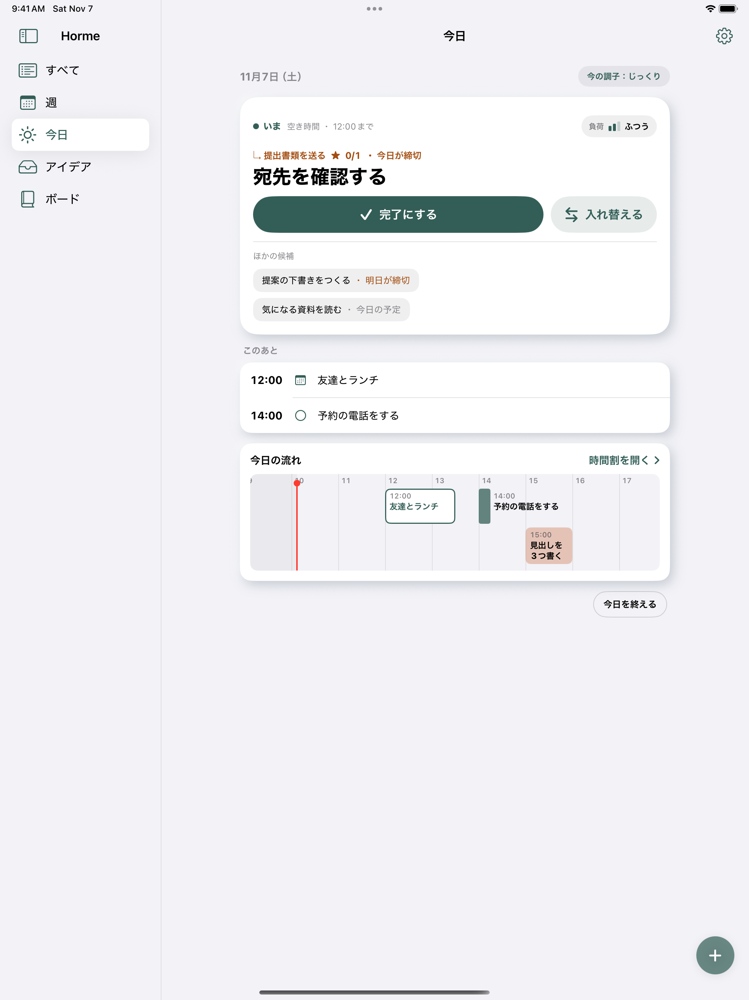 | 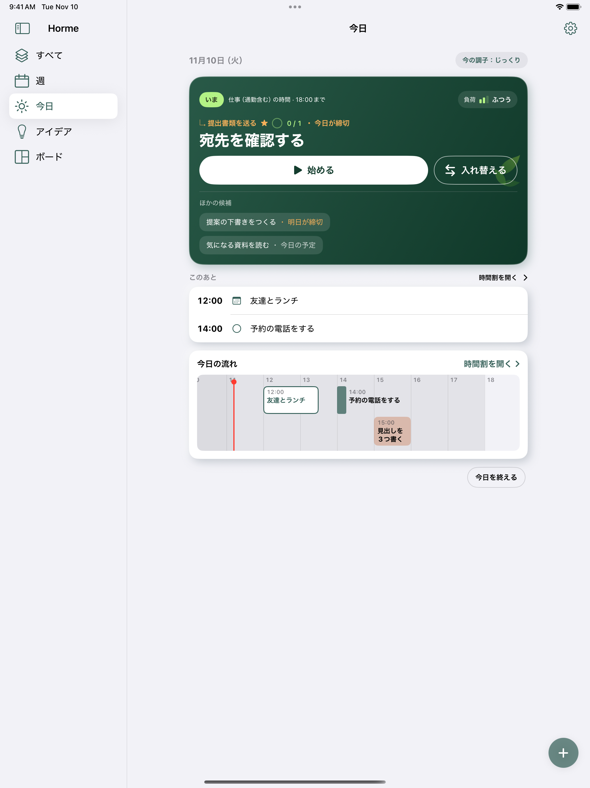 |

カード塗り部分の実測（影・境界のアンチエイリアスを除く、単位pt）：

| 機種 | 変更前 | 復元後 | 差 |
| --- | --- | --- | --- |
| iPhone | 343 × 324.5 | 343 × 326.5 | 幅同じ・高さ +2 |
| iPad | 588 × 324.5 | 588 × 326.5 | 幅同じ・高さ +2 |

カードは内容に応じた高さを維持します。追加表示に合意したメモがある場合などは内容に応じて高さが増えます。

## iPadの週と山画面

| 変更前 | 復元後 |
| --- | --- |
| 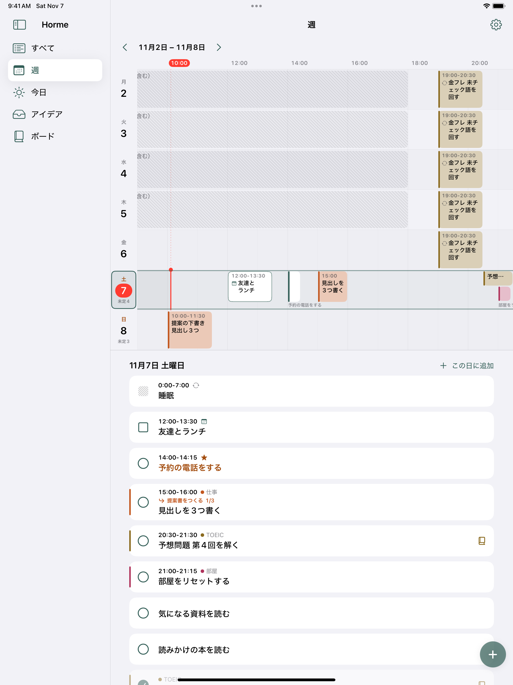 | 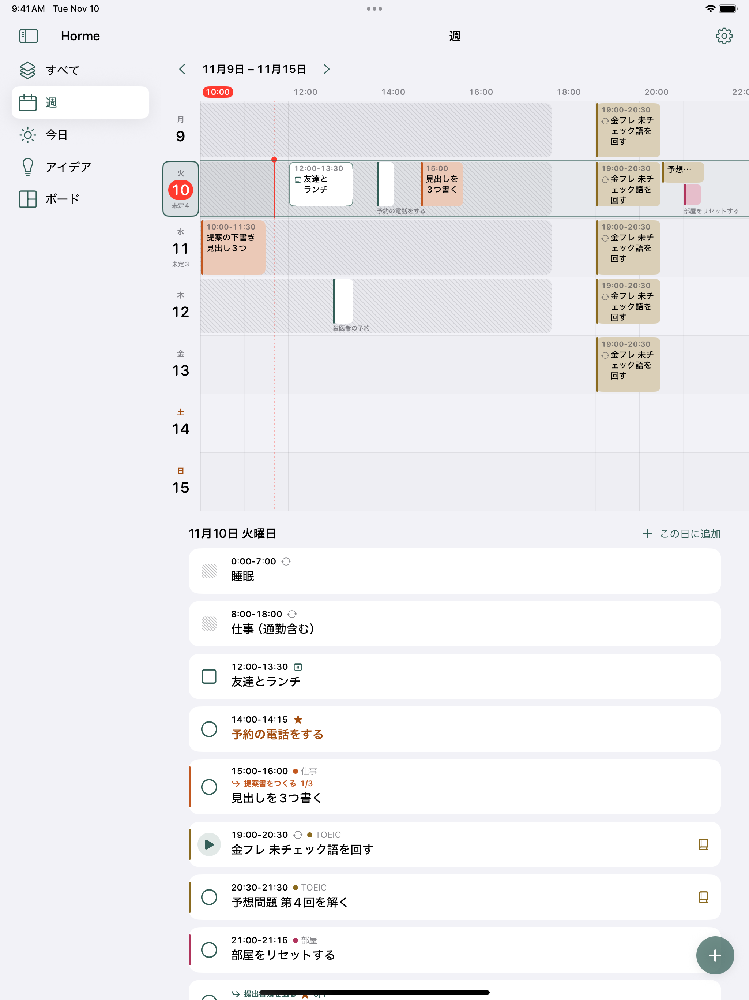 |
| 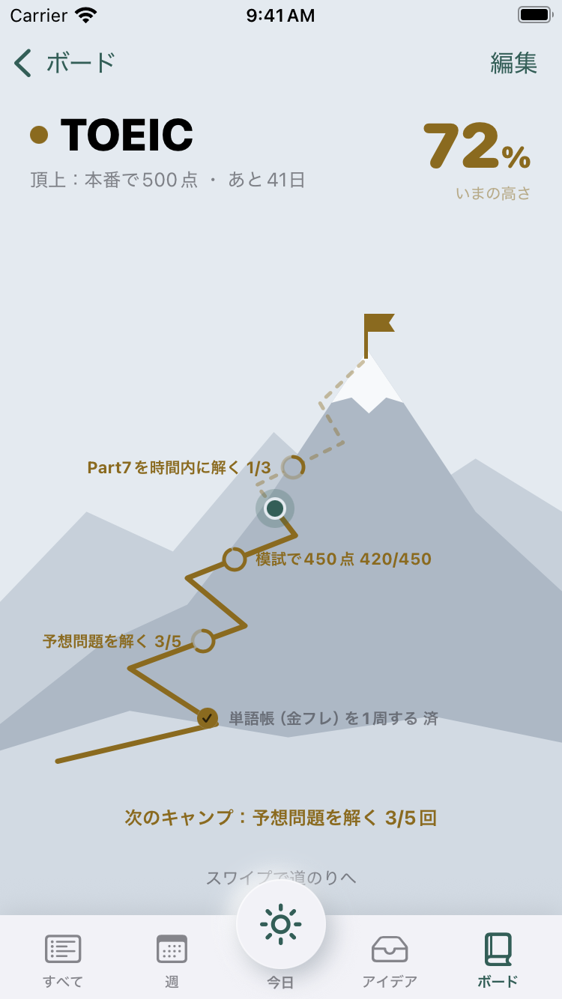 | 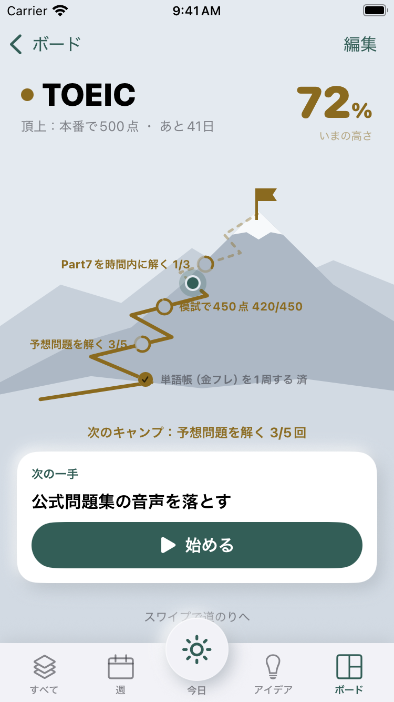 |

## 復元した横軸・候補メニュー・合意済み時間割

実際の操作テストで、横軸のスクロールから時間割を開く、右端候補メニューを開く、調子で絞る、候補から編集する、という既存の導線を確認しました。操作テストの画像はデモモードのため、上部に既存のオレンジ色の帯が表示されています。

| ホームの横軸 | 右端の候補メニュー | 合意済みの時間割 |
| --- | --- | --- |
| 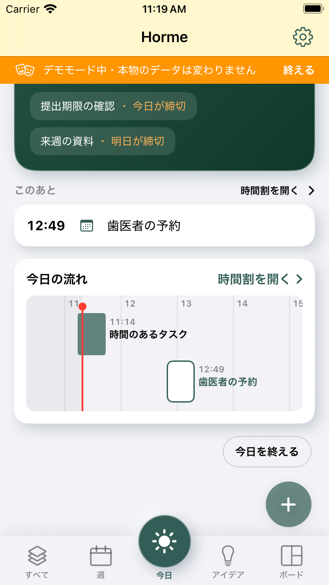 | 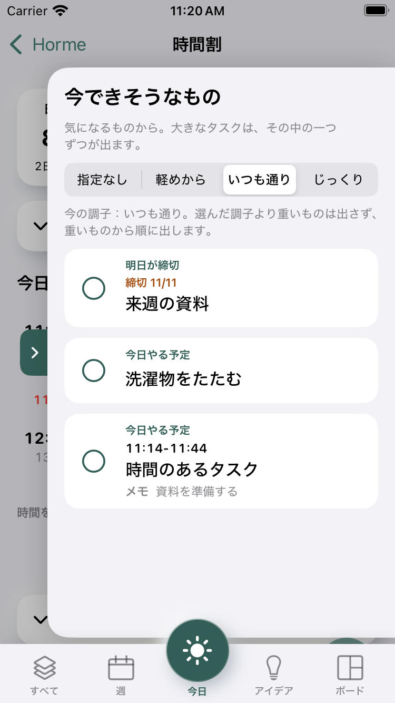 | 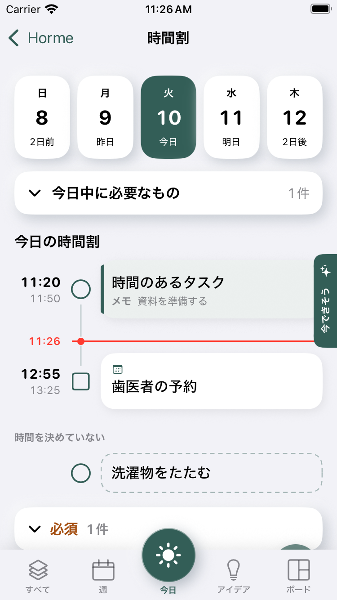 |

iPadでは元の右側候補パネルも維持しています。

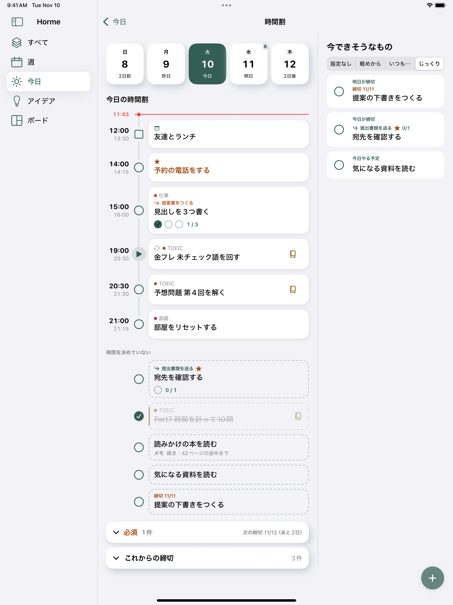

## 既存の終了日・画面復帰の扱い

今日を終了済みなら既存の「再開する」を維持し、作成済みタスクを保ったまま開始不可を案内します。再試行でタスクは増えません。通常のタブ復帰では開いていた時間割を閉じません。

| 開始できない時の案内 | 今日の終了状態 | 通常のタブ復帰 |
| --- | --- | --- |
| 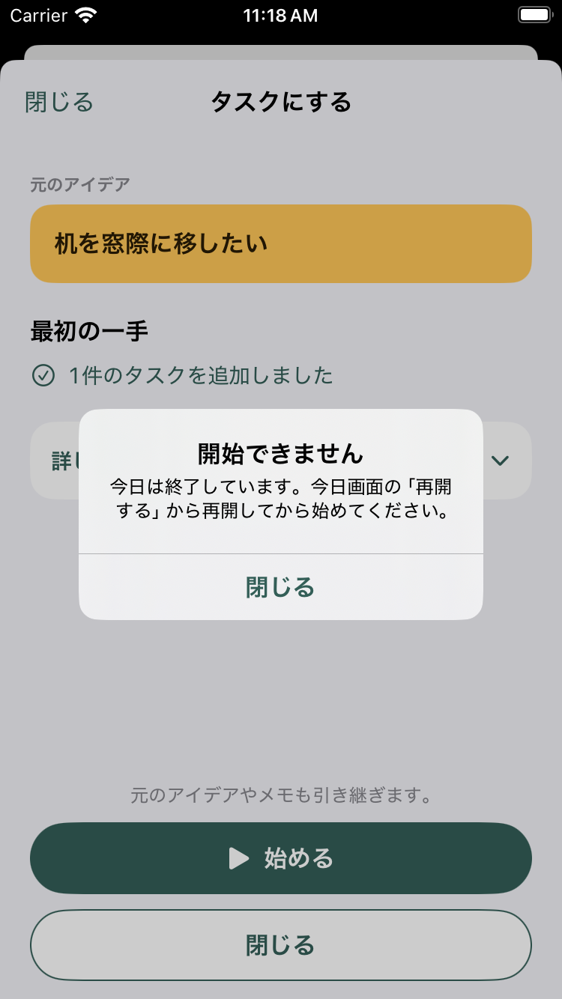 | 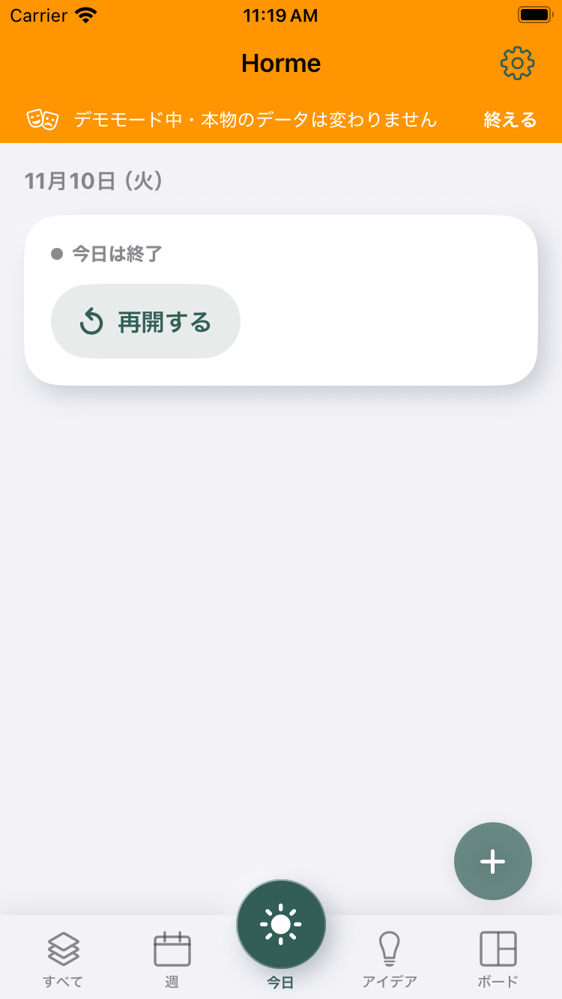 | 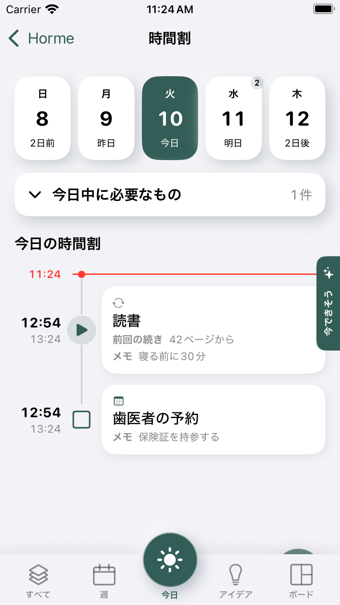 |

## 検証

画面操作テスト12件成功・失敗0・スキップ0。[結果の原本](ui/interface-summary.json)。Coreテスト103件・配布スクリプトのテスト17件、Simulator Debug／iOS Releaseビルド、iPhone／iPadの起動・既存データ移行確認も成功。[検証情報と画像ハッシュ](validation.json)。
