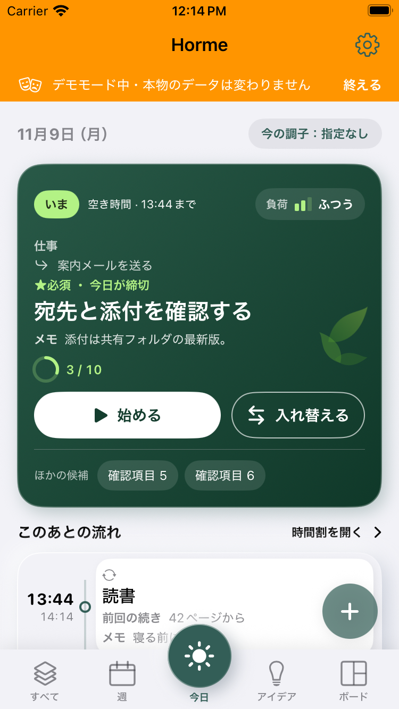
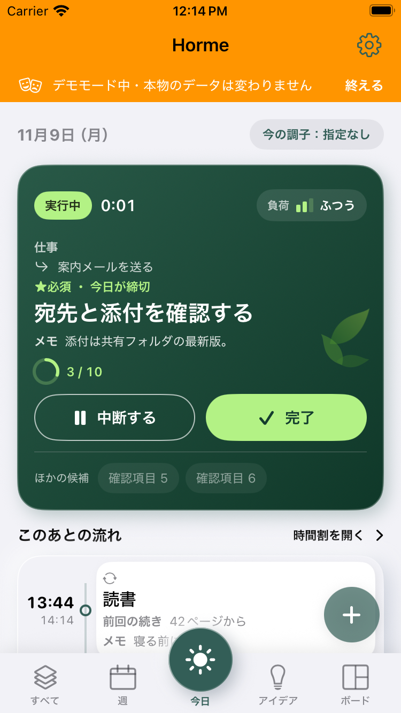
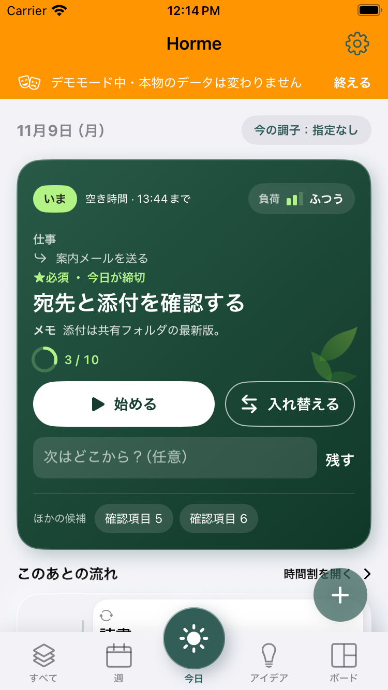

# Horme：実際にビルドしたアプリ画面

PR #1 のソース `d945d724bb381174dc538be59d359a7a93d1768f` を Xcode 26.3 でビルドし、iPhone SE（第3世代）/ iOS 18.5 シミュレーターで操作して取得した画像です。画像生成モックではありません。

[UI操作テスト・ビルド確認](https://github.com/reiji55/Todo-for-adhd-iOS.-/actions/runs/42614132802) · [テスト結果JSON](validation.json)

オレンジ色の帯は、検証用サンプルを使っていることを示す既存のデモ表示です。通常利用時には表示されません。

| 開始前 | 実行中 |
| --- | --- |
|  |  |

| 中断後の任意メモ | 5日分の時間割（ダーク） |
| --- | --- |
|  |  |

そのほかの画面：

- [メモありの今日画面（ダーク）](today-with-notes-dark.png)
- [メモ保存後の再開](task-restarted-with-note.png)
- [完了を取り消してメモも復元](task-completion-undone.png)
- [イベントの完了操作](event-done-only.png)
- [ルーティンの既存の集中画面](routine-existing-focus.png)

このブランチは確認用の画像のみを保持します。アプリのソースやユーザーの本番データは含みません。
